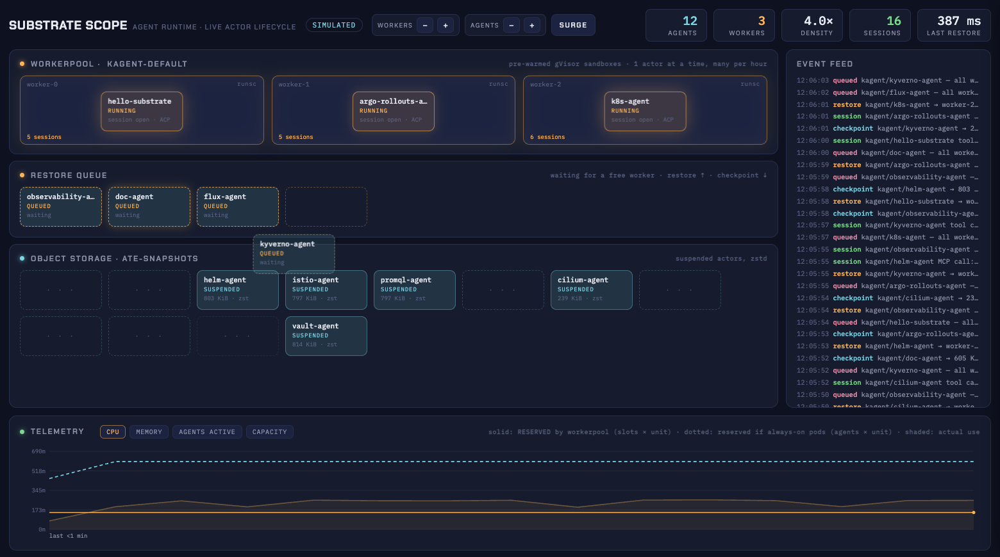

# Substrate Scope

A live visualizer for [Agent Substrate](https://github.com/agent-substrate/substrate),
the Kubernetes-native runtime that runs AI agents as snapshot-backed actors in
gVisor sandboxes instead of always-on pods, driven through
[kagent](https://kagent.dev/) 1.0.



`kubectl get pods` makes Substrate look boring because the interesting state
is not in pods: 19 agents, 3 worker pods. Substrate Scope shows the runtime the
way it actually works:

- **Worker pools**: one labelled row per WorkerPool. Each bay is one actor
  *slot*: a Substrate 1.0 worker pod hosts as many actors as its capacity
  (pod limits) fits at each actor's runtime limits. Every chat is its own
  Session and actor, so one agent can hold several bays at once: its chip
  sits on one, and each parallel session gets a dashed `#2`, `#3` chip on its
  own bay. "N busy" counts bays the inventory says hold an actor. A pool with
  no worker pods is drawn as **NO WORKERS** and turns the banner red.
- **Restore queue**: requests waiting for a slot. Substrate 1.0 *parks* them in
  atenet-router (~5 s), then the kagent gateway answers "input was not
  accepted; retry"; Scope shows both layers (parked in router / client retry),
  one chip per waiting **chat** (a second chat for a busy agent queues too),
  plus the router's parking gauge and the router / scheduler failure counts.
  Those count from 0 when the page loads, and again from START and from each
  SURGE, never from an old rehearsal (pod lifetime totals are in the tooltip).
  Parking from clients Scope did not send is labelled as such.
- **Object storage shelf**: every suspended agent as a snapshot, with
  per-agent snapshot counts (`1 snapshot`, `N snapshots`).
- **👻 Ghosts**: rc2 can leave an actor stuck in Resuming after a cancelled
  restore, holding a worker slot. An actor Resuming on a bay for over 20 s gets
  a 👻 badge (and the pool row a ghost count), the feed says
  `👻 <agent> stuck Resuming for Ns — RESET POOL frees it`, its time is not
  counted as work on the Fairness tab, and RESET POOL bounces every pool that
  holds one and logs when it is cleared.
- **Chips that move**: agents fly storage → queue → slot → storage as they
  restore, run, and checkpoint.
- **Telemetry**: what the worker pods reserve vs. the dotted "if these were
  all always-on pods" line, agents active, slot occupancy, fairness, with the
  newest sample as one line of numbers next to the tabs (`reserved 500m vs
  always-on 1800m (3.6×)`). Every assumption is printed under the chart.
- **Click into an agent**: prompts in, replies out with latency, restores onto
  a named pod/slot, checkpoints, errors verbatim, and a box to talk to it.
  Chats started in the kagent UI (or anywhere else) show up too. What was
  replayed from before the page loaded sits under a divider, newest few only.
- **Session view**: VIEW: AGENTS / SESSIONS (or `?group=session`), see below.
- **Controls that are real**: per-pool +/- runs `kubectl scale workerpool`,
  AUTOSCALE scales the real CR on demand, RESET POOL restarts the worker
  Deployment, STOP DEMO halts every billable chat.
- **Fails loudly**: if the controller is unreachable, is an older kagent, or
  returns an empty inventory, a red banner says exactly what is wrong. If the
  browser loses Scope itself (server down, network blip, laptop sleep), the
  badge turns DISCONNECTED or STALE, the board greys out, and it recovers by
  itself when Scope is back.

## Version pins

Validated together on a kind cluster (2026-11-04):

| Component | Version |
| --- | --- |
| kagent (controller, UI, CLI, Helm charts `oci://ghcr.io/kagent-dev/kagent/helm/{kagent-crds,kagent}`) | `1.0.0-rc2` (git `4a5c758`) |
| Agent Substrate (Helm charts `oci://ghcr.io/kagent-dev/substrate/helm/{substrate-crds,substrate-podcert,substrate}`) | `1.0.0-rc2` (source tag `v1.0.0-rc.2`) |
| Worker image | `ghcr.io/kagent-dev/substrate/ateworker-gvisor:v1.0.0-rc2` |
| Kubernetes | kind `v0.33.0`, node image `kindest/node:v1.37.0` |
| Model | Anthropic `claude-haiku-4-5` (`ModelConfig default-model-config`) |
| node | >= 20.3 (`AbortSignal.any`; tested on 25.2.1); zero npm dependencies |

Scope 0.1 (git history before this port) targets kagent 0.10 + Substrate 0.0.9.
Pointed at a 0.10 controller this build detects it and draws the board
read-only with a warning.

## Quickstart (kind + kagent 1.0.0-rc2)

```bash
# 1. a kind cluster prepared for Substrate (local registry, gVisor-ready nodes)
git clone --branch v1.0.0-rc.2 https://github.com/agent-substrate/substrate.git
KIND_CLUSTER_NAME=substrate-day substrate/hack/create-kind-cluster.sh

# 2. kagent 1.0.0-rc2 with Substrate, via the kagent CLI
#    (release asset kagent-<os>-<arch> from github.com/kagent-dev/kagent/releases/tag/v1.0.0-rc2)
cat > kagent-cli-config.yaml <<'EOF'
install:
  defaultModelProvider: Anthropic
EOF
export ANTHROPIC_API_KEY=...            # read it from a file; never paste it in a shared terminal
kagent --config kagent-cli-config.yaml install

# 3. size the worker pods so the pool can fill (see "Worker sizing")
kubectl --context kind-substrate-day patch workerpool.ate.dev kagent-default -n kagent --type merge \
  -p '{"spec":{"template":{"resources":{"requests":{"cpu":"250m","memory":"512Mi"},"limits":{"cpu":"2","memory":"2304Mi"}}}}}'
kubectl --context kind-substrate-day scale workerpool.ate.dev kagent-default -n kagent --replicas=2

# 4. the demo fleet: 13 agents on the built-in `kagent` Harness
git clone https://github.com/themsquared/substrate-scope.git && cd substrate-scope
kubectl --context kind-substrate-day apply --dry-run=server -f deploy/fleet.yaml
kubectl --context kind-substrate-day apply -f deploy/fleet.yaml
kubectl --context kind-substrate-day wait --for=condition=Ready agents.api.kagent.dev \
  -n kagent -l demo=substrate-scope --timeout=300s

# 5. run it
KUBE_CONTEXT=kind-substrate-day node server.mjs --live     # http://127.0.0.1:8123
KUBE_CONTEXT=kind-substrate-day deploy/preflight.sh        # before you go on stage
```

`node server.mjs` without `--live` is a fully simulated board: no cluster needed.

Scope listens on **127.0.0.1 only**: its POST endpoints send billable chats
and scale pools. `HOST=0.0.0.0` shares the board on a LAN (every POST is
logged with its source address; POSTs from another site's page are refused).

Scope port-forwards `svc/kagent-controller` and `svc/kagent-ui` itself, each to
a free local port (printed at start; the board's header links the kagent UI).
A respawned forward (pod restart, dropped connection) keeps its port; set
`KAGENT_API_PORT` / `KAGENT_UI_PORT` to pin them across Scope restarts too.
The forwards run under a small `sh` guard, so they die with Scope even on
`kill -9`. Set `KAGENT_API=http://127.0.0.1:8083` to use your own forward
instead.

STOP DEMO, AUTOSCALE and the chat counter are kept in
`$TMPDIR/substrate-scope-<PORT>.json`: a Scope restarted within 30 minutes
comes back in the same state (and says so in the console and the feed).
`SCOPE_START_STOPPED=1` always starts with the demo stopped.

## How live mode reads kagent 1.0

kagent 1.0 removed the controller's REST API (`/api/substrate/status` now answers
an **empty 200** from a catch-all). Scope speaks the new surfaces directly:

| What | How |
| --- | --- |
| Pools, workers, actors, templates | gRPC-Web `kagent.api.v1.SystemService/{GetSubstrateSummary, ListSubstrateActors, ListSubstrateWorkers}` (paged at 100), zero-dep client in `lib/grpcweb.mjs` against `lib/schema.json` |
| Worker ↔ actor join | `actor.status.worker_assignment.worker_pod` (workers no longer name their actor) |
| Actor states | `ACTOR_STATE_RESUMING/RUNNING/SUSPENDING/SUSPENDED/CRASHED/…` → Resuming/Running/… |
| Agent names | generated template names `<agent>-<12 hex>` (16 hex on 0.10) are stripped |
| Chat | `POST /agents/{ns}/{name}`, JSON-RPC `SendMessage`, header `A2A-Version: 1.0`, no contextId = new Session |
| Chats from the kagent UI | gRPC-Web `SessionService/ListSessions` + A2A `ListTasks` (per agent, `statusTimestampAfter`) |
| Agent → pool | `agents.api.kagent.dev` `spec.harnessRef` → `harnesses.api.kagent.dev` `spec.substrate.workerPoolRef` (kubectl) |
| Actor size | controller ConfigMap `runtimeDefaults` (limits, default cpu 1 / memory 1Gi) |
| Parking / capacity | Prometheus via the API server pod proxy: `agentgateway_substrate_request_parking_active` (atenet-router :15020), `agentgateway_atenet_router_route_duration_seconds_count{ate_router_outcome}`, `ate_scheduler_assignment_duration_seconds_count{ate_scheduler_outcome="no_capacity"}` (ate-api-server :9090) |
| Worker CPU / memory | kubelet `stats/summary` through the API server (no metrics-server) |

Regenerate the schema for another release with
`python3 tools/gen-schema.py <FileDescriptorSet> > lib/schema.json`
(see the script header for building the descriptor set from kagent's `proto/`).

## Worker sizing

A Substrate 1.0 worker reports its capacity from its pod **limits** (downward
API). Without limits it advertises the whole node (12 CPUs / 31 GiB on the test
VM), i.e. ~12 actor slots per pod, and a demo pool never fills. Actors are
placed at their runtime limits (1 CPU / 1 GiB), so `limits: cpu 2, memory
2304Mi` gives 2 slots per pod (the worker keeps 64 MiB for itself). With 2 pods:
4 slots for 14 agents. `deploy/preflight.sh` warns about pools without limits.
To make it permanent set `substrateWorkerPool.template.resources` in the kagent
Helm values; the `kubectl patch` above is undone by a Helm upgrade.

## Telemetry: what the numbers mean

- **Reserved by worker pods** (solid): the WorkerPool's pod `requests` × running
  pods, from the cluster. A pool with no requests set falls back to
  `slots × unit` and says so.
- **If always-on** (dotted): Ready agents × one always-on pod's requests. kagent
  1.0 has no always-on agents to measure, so the unit is an explicit, labelled
  assumption: kagent v0.10.5's default Agent Deployment requests, **100m CPU /
  384Mi** (`go/core/internal/controller/translator/agent/deployments.go`;
  limits there were 2000m / 1Gi). Override with `UNIT_CPU_M`, `UNIT_MEM_MI`,
  `UNIT_SOURCE`.
- **Actual use** (shaded): kubelet working set / CPU of the worker pods.
- **Like for like**: both lines cover the same pools. A pool without pod
  requests has nothing measured to compare, so it is left out of both lines
  and named in the footnote (unless no pool sets requests; then every pool
  uses the labelled `slots × unit` fallback).
- **The crossover is real**: at 250m per worker pod and 100m per always-on
  agent, the reserved line rises above the dotted one once the pods outnumber
  agents ÷ 2.5 (19 agents: 8 pods; the default pool's 14 agents alone: 6).
  A full SURGE with AUTOSCALE ON drives the default pool to 7 pods for about
  30 s. Show the Telemetry tab after the walk-down, and rehearse it.

## Load generation

`stimulate.mjs` sends real chats to random agents in the default pool. **Always
set a budget on a paid model.**

```bash
node stimulate.mjs --budget 20
node stimulate.mjs --budget 30 --concurrency 8 --load 1
node stimulate.mjs --pool all --budget 10      # include every pool
```

Flags: `--budget N` (stop this generator after N chats; the demo keeps
running), `--halt-demo` (also flip STOP DEMO when the budget is reached),
`--concurrency N` (else pool slots + `--oversub`, default 3), `--load 0..1`
(fraction of long-form prompts, default 0.5), `--interval S`, `--hog <agent>`
and `--hog-share 0..1` (one agent gets that share of chats, all long-form:
a noisy neighbor for the Fairness tab). It reads the controller address and
agent list from a running Scope (`/agents`), or from `KAGENT_API` and kubectl.

- STOP DEMO reaches it within ~0.5 s. While a TALK TO IT chat from the drawer
  is in flight (and 8 s after), it dispatches nothing new.
- Size the budget for the talk: at ~6 in flight and 3-8 s turns, 20 chats
  last well under a minute. On stage use `--oversub 0` so it never keeps
  chats parked in the router ahead of TALK TO IT (parking has no priority).
- If Scope's controller port-forward moves (Scope or controller restart), it
  picks up the new address from Scope. A turn whose connection died mid-send
  is looked up by messageId (A2A ListTasks) and reported with its real
  outcome; Scope does the same for its own chats.
- Every chat is exactly one new Session (idle TTL 7 days), however often it
  is retried: the Session is created up front (`SessionService/CreateSession`,
  `request_id` = the chat id, named `Scope · stimulator` / `Scope · SURGE` /
  `Scope · TALK TO IT`) and a pool-full send (-32004,
  `KAGENT_SEND_NOT_ACCEPTED`) is retried with that contextId. Before, each
  retry was a fresh SendMessage and made a new Session and actor. `SESSIONS`
  in the header is the cluster's session count; delete rehearsal sessions
  before the show.
- With AUTOSCALE on, pass `--concurrency` (on stage `--concurrency 1 --oversub 0
  --budget 12`): without it the generator follows the pool's slot count, so
  the pool it fills never walks down.

## Session view

Contributed by [@nmnellis](https://github.com/nmnellis) (PR #2) and evolved on
the enterprise board. By default each chip is an agent and its sessions
collapse into a snapshot count. **VIEW: SESSIONS** (the button toggles
`?group=session`, which also works as a deep link) gives each conversation its
own chip, labelled `agent·<session id suffix>`: on kagent 1.0 a Session is one
Substrate actor (`session-<id>`) and the A2A `contextId` *is* the Session id.

- Each session chip's drawer shows only that conversation. Turns Scope did
  not see live (an earlier run, the kagent UI, Telegram) are read back from
  kagent (`GET /session-history`, A2A ListTasks by contextId).
- TALK TO IT from a session chip continues that session (SendMessage with
  its contextId); from an agent chip it starts a new one.
- A waiting chat queues on its own session's chip; a temporary chip for a
  session the inventory does not list yet leaves when its turn is admitted.
- Telegram conversations (`📱` prompts, `📱 sent` replies) are marked `📱`
  on their chip.
- A cluster keeps every session, so each agent shows its 2 newest sessions
  (`?sessions=N`, up to 10), plus any on a worker, any with activity in the
  last 10 minutes (a Telegram conversation: 6 hours), and the open one. The
  header still counts agents.

## Autoscaling

Off at start; toggle AUTOSCALE in the UI. It acts on `SCOPE_AUTOSCALE_POOLS`
(default `kagent-default`) and counts in replicas, because a pod is several
slots:

```
demand      = actors on the pool's workers
            + max(Scope/stimulate chats waiting for this pool,
                  atenet-router parked requests while this pool is full)
target      = ceil(demand / slots per pod), clamped to [SCOPE_AUTOSCALE_MIN, 8]
floor       a pool below SCOPE_AUTOSCALE_MIN (default 1) replicas is scaled back to it
scale UP    straight to target when anything waits, cooldown 8s
scale DOWN  to ceil(peak demand over 30s / slots per pod) after ~18s of surplus,
            cooldown 20s
```

`kubectl scale` takes field ownership of `WorkerPool.spec.replicas`; a later
Helm upgrade that manages the pool needs `--force-conflicts`.

## Configuration

| Env | Default | |
| --- | --- | --- |
| `KUBE_CONTEXT` | current context | every kubectl call and port-forward is pinned to it |
| `PORT` | `8123` | |
| `HOST` | `127.0.0.1` | `0.0.0.0` to serve the board on the network |
| `KAGENT_API_PORT` / `KAGENT_UI_PORT` | free port | fixed local ports for Scope's port-forwards |
| `SCOPE_START_STOPPED` | unset | `1` = start with STOP DEMO on |
| `SCOPE_STATE_FILE` | `$TMPDIR/substrate-scope-<PORT>.json` | where STOP DEMO / AUTOSCALE survive a restart |
| `KAGENT_API` | own port-forward | controller base URL |
| `SCOPE_POOL` | `kagent-default` | pool for RESET POOL (plus any pool holding a 👻 ghost), header +/-, SURGE |
| `SCOPE_SURGE_POOLS` / `SCOPE_AUTOSCALE_POOLS` | `SCOPE_POOL` | comma-separated |
| `SCOPE_AUTOSCALE_MIN` | `1` | autoscaler floor, in pods (an rc2 worker sized at kagent's booking already holds 2 actors) |
| `SCOPE_MAX_SLOTS` | `8` | bays drawn per worker pod |
| `SCOPE_CHAT_BUDGET` | `0` (none) | cap on chats Scope itself sends |
| `UNIT_CPU_M` / `UNIT_MEM_MI` / `UNIT_SOURCE` | `100` / `384` / kagent 0.10.5 | always-on baseline |

## Endpoints

`GET /events` (SSE), `GET /status` (snapshot, health, router stats, queue),
`GET /agents?pool=` (Ready agents + slots), `GET /metrics.json`,
`POST /scale {pool, replicas}`, `POST /reset {pool}`, `POST /surge`,
`POST /chat {ns, agent, text, wait, contextId}` (contextId continues that session),
`GET /session-history?agent=&ctx=` (one session's turns), `POST /autoscale {on}`,
`POST /demo {run}` (master kill switch; `GET /demo` also says whether a
presenter chat is in flight), `POST /activity`, `POST /queue` (load-generator
reporting, one entry per chat).

## Origin

Built while standing up Agent Substrate with kagent on kind; the write-up is at
[webofmike.com/kagent-agent-substrate](https://webofmike.com/kagent-agent-substrate/).

## License

Apache-2.0
